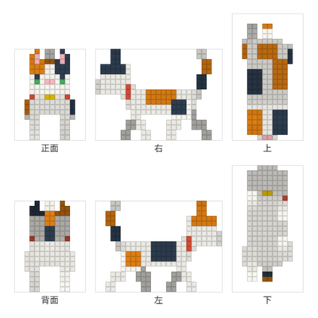
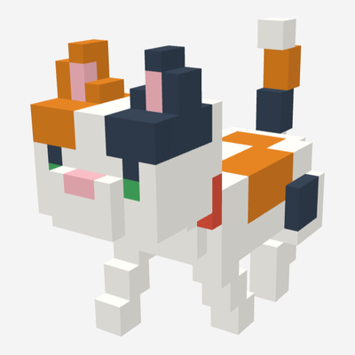
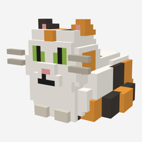
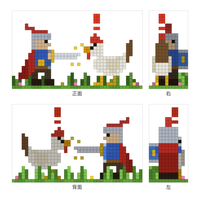
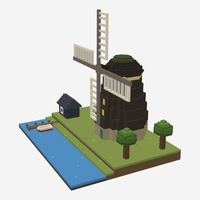

# VoxelGraft

  

> 状態: 開発初期(M1〜M2 完了。M3 以降は未着手、M4 は暫定)。開発が落ち着くまでは、npmへの公開、公式マーケットプレイスへの申請は行いません。

開発はまだ始まったばかりで、最低限の機能しかありません。

エージェントでAIと対話しながらボクセルアセットを生成するためのSkills。
Claude Codeでの使用に最適化。Command Code、Antigravity CLI、Piでも動作することは確認。
ただし、Claude Code以外ではコマンドパスの自動探索処理が入るため、起動時のトークン消費がやや多くなる。

## 出力例

  
  

Gemini 3.8 Flash が VoxelGraft DSL を記述し、voxelgraft でHTMLへ書き出した例。
左は Canvas 2D 版、右は Three.js 版。

HTMLをダウンロードし、ブラウザで開くことでサンプルの動作確認可能: [Canvas 2D 版](examples/gemini-3-8-flash/walking_cat_v2.html) ・ [Three.js 版](examples/gemini-3-8-flash/walking_cat_v2.three.html)

書き出しの形式は、現時点で次の3種類。

- `html`: Canvas 2D 版。1ファイルのHTML。斜め、正面・右・背面・左・上・下、六面同時の並びをボタンで切り替え可
- `vox`: MagicaVoxel の .vox ファイル
- `three`: Three.js 版。.vox を埋め込んだHTML。回転とズーム可。Three.js を CDN から読む

### その他の作例

  
  
  

| 作例 | モデル | 形式 | 大きさ | ボクセル数 |
|---|---|---|---|--:|
| [香箱座りの猫](examples/deepseek-v4-1-flash/loaf_calico.three.html) | DeepSeek V4.1 Flash | Three.js 版 | 24 × 21 × 30 | 4,190 |
| [鶏 vs 勇者](examples/claude-sonnet-5-5/hero_vs_chicken.html) | Claude Sonnet 5.5 | Canvas 2D 版 | 40 × 24 × 12 | 1,543 |
| [オランダ風車](examples/claude-sonnet-5-5/dutch_windmill_v2.three.html) | Claude Sonnet 5.5 | Three.js 版 | 72 × 70 × 56 | 32,346 |

## コマンド実行

    bin/voxelgraft help
    bin/voxelgraft check examples/chest.json
    bin/voxelgraft build examples/chest.json --out out

> 現時点では Node v22 の `--experimental-transform-types` で、TypeScriptをそのまま動かす。

## Claude プラグインとしての試用

    claude --plugin-dir /path/to/voxelgraft

bin/ が PATH に入り、Skill から `voxelgraft` の名で実行可能。このオプションでは、起動する際の1回限りの読み込みとなる。

Skill は依頼の内容(「voxelgraftでアセット制作」等、発動条件は厳しめ)から自動で呼ばれるほか、`/voxelgraft:voxelgraft` で手動実行も可

> Skillsとして有効化しなくても、SKILL.mdの内容と`voxelgraft help`の出力をAIエージェントに読ませれば使用可能とする設計方針。

## ライセンス

Apache License 2.0。詳細は [LICENSE](LICENSE) を参照。

# 以下は開発AIエージェント向け補足

## 型の検査

    npm install
    npm run typecheck

実行は型を検査しない（型を取り除くだけ）ので、型の誤りは typecheck で

## 今の範囲（M2）

- check、build、help
- 操作は fill と remove、検査は bounds と palette、書き出しは html、vox（MagicaVoxel の .vox）と three（Three.js による表示）
- Part どうしで座標が重なったら、asset.parts で後の Part が上書きする

## 仮のもの

- 結果の形（JSON）と、HTML の作り（1 ファイル、描く処理も自前）は仮。X3、X6 で比べる
- 管の時間切れは、事実上なくしている（X5 で扱う）

## 由来

- src/cell/ は、セルアーキテクチャ(本体は、まだ未公開)の試作コードから写した。
- 標識（M1、X1 等）の解説は [docs/labels.md](docs/labels.md)、依存関係を含むロードマップは [docs/roadmap.md](docs/roadmap.md) に記す。
