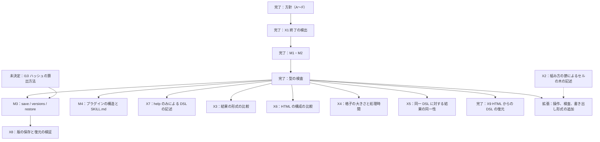

# ロードマップ

## 目標とする構成

Claude Code（エージェント）は、Skills から VoxelGraft の説明書を得て DSL を記述し、
`voxelgraft` により検証と組み立てを行う。人間は HTML により結果を確認する。
対話を重ね、アセットを Part 単位で段階的に育てる。

```
Claude Code（エージェント）
|-- 人間との対話、解釈、計画、DSL の記述
`-- Skills ---- 造形の知識、help 形式の説明書
人間 ---- DSL の直接修正、HTML による確認（閲覧専用）
voxelgraft（実行ごとに世界を構築し、終了後に破棄する）
`-- Root Cell ＝ Voxel Engine
ファイル ---- DSL、版、出力（結果、HTML）
```

## 決定事項

### 構成

1. エージェントは Claude Code とする。説明書は UNIX の help 形式に統一し、`voxelgraft help` に置く。SKILL.md はその出力を差し込み、記述は最小限とする
2. 対話は人間とエージェントの間で行う。HTML は閲覧専用とする
3. 手動の編集は、人間による DSL の直接修正とする
4. 実行ごとに世界を構築し、終了後に破棄する
5. セルの世界（Root Cell 以下）を、そのまま Voxel Engine とする

### DSL

6. 一つのファイルに asset、parts、assembly の三節を持つ。表面は JSON とする
7. DSL は、アセットの形とセルの組み方の双方を記述する（現状の組み方の節は、検査と書き出しの選択）
8. 一つの vesicle に一つの Part を載せる
9. Part 間で座標が重なる場合、asset.parts において後の Part が上書きする

### 版

10. 版は全体を保存する
11. 版は `save` の明示的な実行により作成する。実行は常に可能とし、通過 / 不通過 / 未検証の状態を記録する

### 実装

12. コマンド名は `voxelgraft` とし、独立した git リポジトリとする
13. 結果の形式は JSON、HTML は 1 ファイル・自前の描画とする。いずれも暫定とし、X3、X6 で比較する
14. 終了の検出は quiescence による（X1）
15. 管の時間切れとプロセスの一時停止の関係は X5 で扱う。それまでは段をすべて同期とし、時間切れを事実上無効とする
16. 型の検査は `npm run typecheck` による

### 記述規則

17. 考察の標識（X1、M4 等）は、コードおよび文書にそのまま記してよい
18. 前のプロジェクトのファイル名や所在は、本リポジトリに記さない
19. コミットの文面は Conventional Commits の形式、英語、トレーラーなしとし、適度に改行する

### 配布

20. 配布は Claude Code のプラグインの形とし、CLI（bin/）と Skill（skills/）を同梱する

## 到達状況

| コミット | 内容 |
|---|---|
| efc8cd0 | M1・M2：check、build、help。DSL、世界、操作、検査、組み立て、HTML、例 |
| 369c638 | 型の検査（typescript、@types/node、tsconfig.json） |
| 16ee62a | 文書：標識の解説（docs/labels.md）とロードマップ（本書） |
| b5ec304 | HTML：真正面から見た図（正面・右・背面・左・上・下）と六面の並び。面の境界の白線の解消 |
| 6235715 | M4（暫定）：プラグインの構造（.claude-plugin/plugin.json）と SKILL.md（help の差し込み） |
| 2dde3d9 | 例：サンプル 6 件（calico_cat ほか）と、全サンプルの HTML。意図的に失敗する例（broken_dsl、out_of_bounds）の削除 |
| 96f7fa2 | README：Skill の手動の呼び出し |
| d5f91a6 | X9：HTML からの DSL の復元（experiments/restore/） |

## 依存関係

矢印：「前者を前提とする」関係（優先順位ではない）。



- M3 は版に状態を記録するため、I10（ハッシュの算出方法）の決定を前提とする
- M4 は help を SKILL.md に差し込むため、X7 を前提としない。X7 の結果による help の修正は、SKILL.md にそのまま及ぶ
- 現状の世界は段が同期で、時間切れも事実上無効。そのため、X5 の課題は表面化しにくい

## 拡張候補

- 操作：Transform（移動・回転）、Mirror、Extrude 等（初期構想の操作命令による）
- 検査：浮遊ボクセルの検出（連結性）
- 書き出し：HTML 以外の形式
- 組み方の節によるセルの木の記述（X2）
- Skill：造形の要点（形の作り方、重ねる順の使い方等）

## 未決定事項

- I10：DSL のハッシュの算出方法
- 変更のない Part を毎回再構築するか、前の版の出力を再利用するか
- JSON に注記を残す方法（エンジンが読まない欄の設置 / DSL の外への配置 / 設けない）
- G7：役割のまとまりの名称と、コード上の Cell との重なり
